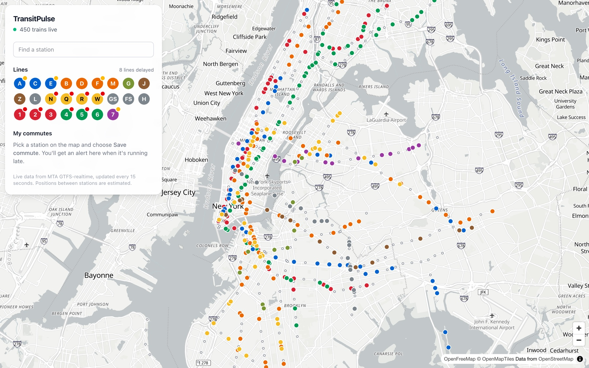
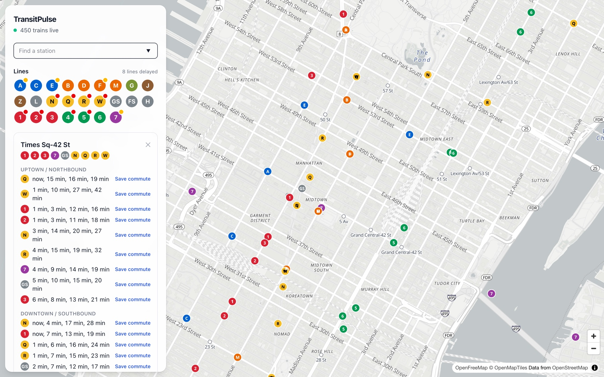
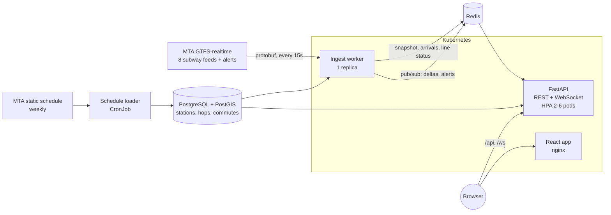

# TransitPulse

[](https://github.com/Zaki-Tahir/transitpulse/actions/workflows/ci.yml)

Every NYC subway train, live on a map. TransitPulse polls the MTA's GTFS-realtime feeds every 15
seconds, works out where each train is between stations, and streams changes to the browser over
WebSockets, where the trains move smoothly in real time. Riders can check the next trains at any
station and save a commute to get an alert when it's running late.



## What it does

- **Live positions for every subway train**: about 450 to 500 at midday across 26 lines, animated as they move.
- **Line status badges** from MTA service alerts: delays, service changes and planned work.
- **Station arrivals** by direction, with big complexes like Times Sq-42 St (four separate stations in the MTA data) shown as one.
- **Commute alerts**: save a line and platform, and get an in-app and browser notification when it becomes late,
  either because the line has a delay alert or because the next train is further out than your threshold.

| Station arrivals | |
| --- | --- |
|  | Click a station or search for one to see the next trains in each direction. Any of them can be saved as a commute. |

## Architecture



### How a train gets on the map

1. **The schedule.** A loader reads the MTA's static GTFS (stations, lines and 560,000 stop times)
   and stores, for every line, each hop between consecutive stations and its median travel time.
   Stations are PostGIS points with a GiST index for nearest-station search.
2. **The feeds.** The ingest worker fetches all eight subway feeds in parallel. A feed that fails
   is skipped. If they all fail, the last known trains stay on the map rather than vanishing.
3. **Where is the train?** The subway feed has **no GPS**. It only says which station a train is
   heading to and when it should arrive. Worse, most moving trains are reported as `STOPPED_AT`
   their last station. So positions come from the predictions instead
   ([realtime.py](backend/transitpulse/realtime.py)): the next stop still ahead, the previous stop
   on that line from the schedule, and the typical hop time. Together these give a departure time,
   so the train is a *motion*: from A (left at T1) to B (arriving at T2). Trips that MTA lists
   before they start are hidden until they're about to leave the terminal.
4. **Only send what changed.** The browser receives one snapshot, then deltas. Each train is a
   compact array (`[id, route, from, to, depart, arrive]`), and it's only re-sent when its stops
   change or its timing moves by more than 20 seconds (a deadband measured against what the browser
   already has, so the error never builds up). The browser does the interpolation, five times a second.
5. **Fan-out.** Each API pod holds one Redis subscription and pushes to its connected browsers from
   memory. A browser that can't keep up is disconnected and resyncs from a fresh snapshot on
   reconnect, rather than growing an unbounded queue on the server.

### Measured: how much the delta format saves

Measured on the live MTA feeds (8 consecutive polls, about 460 trains, weekday late morning). The
ingest worker logs both sizes every poll and reports them at `/api/health`:

| What's sent each poll | Average size |
| --- | --- |
| Every train as a JSON object with its position (the simple approach) | 63.2 KB |
| Only changed trains, compact arrays, 20-second deadband | **10.2 KB (84% less)** |

About 175 of 462 trains change per poll, mostly because they've moved on to the next station.

### Design decisions

- **Send motion, not position.** Because the browser interpolates, a train sitting between two
  stations costs nothing to keep animating. Positions are computed with the server's clock (sent
  with every update), so a wrong clock on the user's machine doesn't misplace trains.
- **Exactly one ingest worker.** The Helm chart runs it with `strategy: Recreate`, so two workers
  never publish at once during a deploy. On start it resumes from the last snapshot in Redis, so a
  restart doesn't re-send every train to every browser.
- **Migrations without a race.** Every API and worker pod runs migrations in an init container,
  serialized by a Postgres advisory lock.
- **Anonymous by design.** No accounts: the browser makes up a client ID and keeps it. Commutes and
  commute alerts are scoped to that ID.

## Tech stack

| Area | Tools |
| --- | --- |
| Backend | Python 3.12, FastAPI, asyncio, WebSockets, asyncpg, redis-py, httpx, GTFS-realtime protobuf, Pydantic |
| Data | PostgreSQL + PostGIS (GiST nearest-station search), Redis (state + pub/sub) |
| Frontend | React 19, TypeScript, MapLibre GL (open-source Mapbox GL fork), Tailwind CSS 4, Vite |
| Infrastructure | Docker, Kubernetes, Helm (HPA, PDB, CronJob, Ingress), GHCR |
| CI/CD | GitHub Actions: ruff, mypy (strict), pytest with PostGIS and Redis, vitest, Helm lint and kubeconform, Playwright end-to-end tests against the full stack in Docker; Helm deploys with automatic rollback |

## Running it locally

Requirements: Docker, [uv](https://docs.astral.sh/uv/), Node.js 22.

```bash
docker compose up -d db redis

cd backend
uv sync
uv run python -m transitpulse.load_static   # downloads the MTA schedule (~6 MB), runs migrations
uv run python -m transitpulse.ingest &      # starts polling live MTA feeds
uv run uvicorn transitpulse.api:app --port 8000 &

cd ../web
npm install
npm run dev                                  # http://localhost:5173
```

No API keys are needed: the MTA subway feeds are public. Bus feeds (MTA Bus Time) need a free key
in `TP_MTA_API_KEY`; generic GTFS-realtime feeds that report GPS positions are supported as well.

Or run everything in containers: `docker compose --profile app up --build`, then open http://localhost:8080.

## Tests

```bash
cd backend && uv run pytest              # 25 tests: unit + integration against PostGIS and Redis
cd web && npm test                       # vitest: interpolation, delta store, station complexes

# End-to-end: the whole stack in Docker, fed with deterministic fixture feeds
cd backend && uv run python -m tests.e2e_fixtures ../data/e2e && cd ..
docker compose -p transitpulse-e2e -f docker-compose.yml -f docker-compose.e2e.yml --profile app up -d --build --wait
cd web && npx playwright install chromium && npx playwright test
```

The backend tests include a real recorded MTA feed, the snapshot-then-delta WebSocket flow,
commute alerts firing once (not every poll) when a line becomes delayed, and surviving a broken feed.

## Deploying to Kubernetes

The Helm chart in [deploy/helm/transitpulse](deploy/helm/transitpulse) runs the API (with a
HorizontalPodAutoscaler and PodDisruptionBudget), the ingest worker, the web app, an Ingress that
sends `/api` and `/ws` to the API with long WebSocket timeouts, and the schedule loader (after each
release and weekly). It can also run in-cluster PostGIS and Redis for a demo cluster; for production,
point `database.existingSecret` at managed services.

```bash
helm upgrade --install transitpulse deploy/helm/transitpulse --set ingress.host=transit.example.com
```

The chart passes `helm lint` and strict Kubernetes schema validation (kubeconform) in CI. The
[deploy workflow](.github/workflows/deploy.yml) builds both images, pushes them to GHCR tagged with
the commit SHA, and runs `helm upgrade --atomic` after CI (including Playwright) passes on `main`.
It's opt-in: add a `KUBE_CONFIG` secret and `K8S_NAMESPACE`, `APP_HOST` and `DB_SECRET_NAME`
variables to the `production` environment, then set `DEPLOY_ENABLED=true`.

## Project layout

```
backend/
  transitpulse/
    gtfs_static.py   schedule -> stations, lines, hop times
    realtime.py      feed parsing, train motion estimates
    delta.py         wire format and deadband diff
    alerts.py        line status from service alerts
    commutes.py      when is a commute "late"
    ingest.py        the polling worker
    api.py, hub.py   REST, WebSocket and Redis fan-out
  migrations/        SQL migrations (PostGIS)
  tests/             unit, integration, e2e fixture generator, recorded MTA feed
web/
  src/lib/           WebSocket client, vehicle store, interpolation
  src/components/    map, lines, station arrivals, commutes
  e2e/               Playwright tests
deploy/helm/         Kubernetes chart
```

## Data

Subway data from the [MTA developer feeds](https://api.mta.info/). Map tiles from
[OpenFreeMap](https://openfreemap.org/), map data © OpenStreetMap contributors. Positions between
stations are estimates.

## License

MIT
